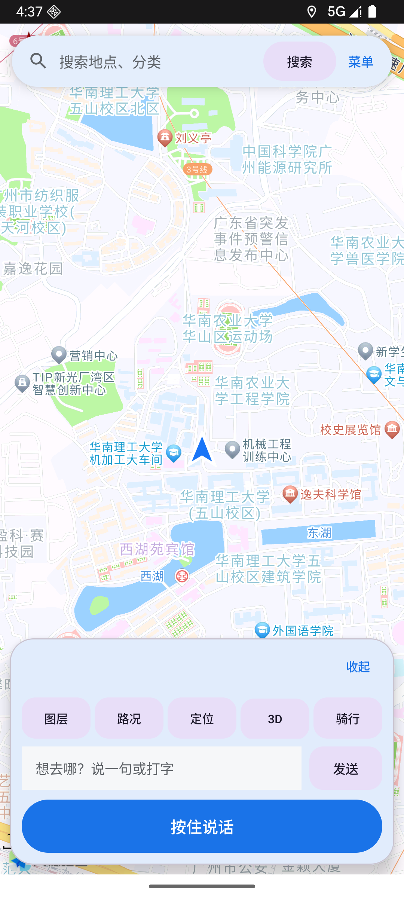
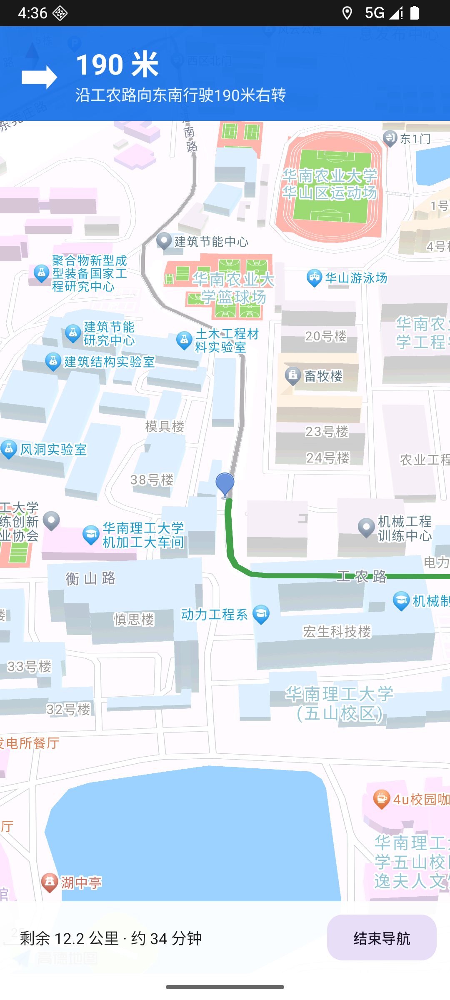
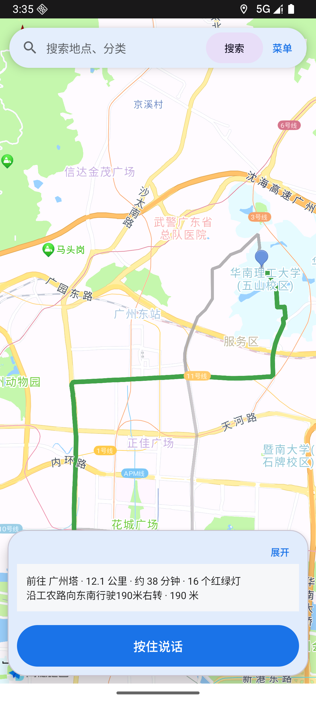
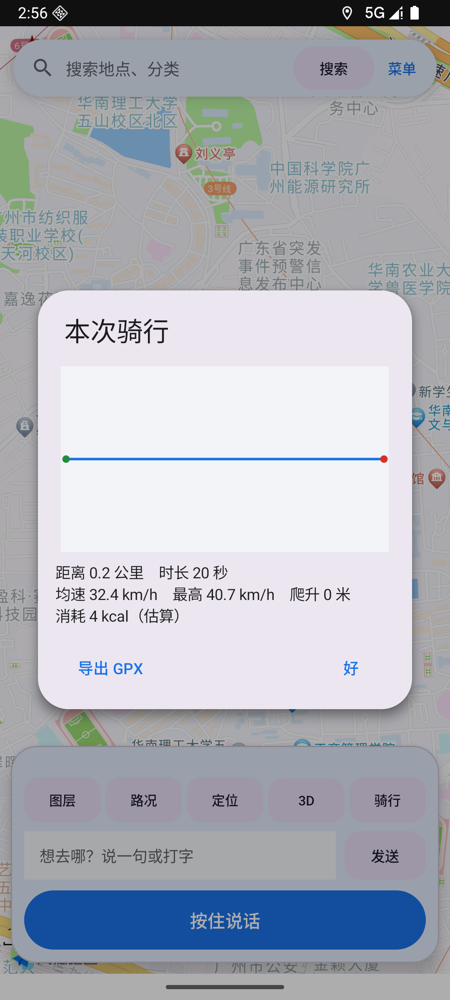
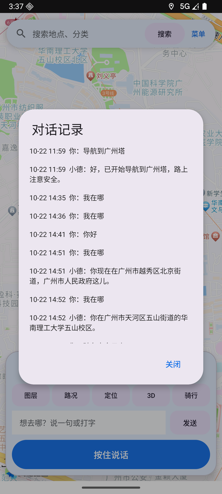

# MapMate — 会说话的手机地图

高德地图 + 语音 Agent 的自用导航 App。说一句「导航到广州塔」，它规划路线、画出路线、沿途播报转向。
## 截图

| 主界面 · 定位箭头 | 导航模式 |
|---|---|
|  |  |

| 路线 + 可折叠面板 | 骑行总结（轨迹缩略图） |
|---|---|
|  |  |

| 对话记录 | |
|---|---|
|  | |

## 快速开始

```bash
# 环境：JDK 21、Android SDK 35、Gradle 8.9
export JAVA_HOME=/path/to/jdk-21
export ANDROID_HOME=/path/to/android-sdk

gradle assembleDebug
# 产物：app/build/outputs/apk/debug/app-debug.apk
```

首次运行需要在高德开放平台申请 **Android Key**（已在 `AndroidManifest.xml` 中）和 **Web 服务 Key**（`RoutePlanner` / `Geocoder` / `Weather` 共用）。
Agent 的 DeepSeek Key 在 App 内「菜单 → 设置」里填，不写进代码。

## 架构

```
┌──────────── Android (MapMate) ────────────┐
│ 高德地图 SDK 10.0.600                      │
│   ├─ 地图渲染 / 定位 / 相机                 │
│   ├─ 折线绘制 / 起终点标记                  │
│   └─ 语音：AudioRecord → Opus → WS          │
│        Opus → AudioTrack ← WS               │
│                                            │
│  NavCore（纯 Java）：路径匹配 / 偏航 / 到达  │
│  Guidance：LocationManager + TTS 播报       │
│  Geocoder / RoutePlanner：高德 Web API      │
└──────────────────┬─────────────────────────┘
                   │ ws://<host>:8000/xiaozhi/v1/
┌──────────────────▼─────────────────────────┐
│  xiaozhi-esp32-server（Python）             │
│   ASR: FunASR SenseVoiceSmall（本地）        │
│   LLM: DeepSeek deepseek-flash              │
│   TTS: EdgeTTS                              │
│   VAD: Silero                               │
└────────────────────────────────────────────┘
```

## 协议（小智 IoT 通道）

App 在 `hello` 之后声明设备能力，服务端自动注册成 function calling 工具：

```json
{"type":"iot","descriptors":[{
  "name":"map",
  "description":"用户的手机地图",
  "properties":{
    "location":{"description":"用户当前所在地点描述","type":"string"},
    "route":{"description":"最近一次规划的路线概要","type":"string"}
  },
  "methods":{
    "navigate":{"description":"让手机地图导航到指定地点",
      "parameters":{"place":{"description":"目的地名称或地址","type":"string"}}},
    "stop_navigation":{"description":"结束当前导航并清除地图上的路线"}
  }
}]}
```

服务端下发：

```json
{"type":"iot","commands":[{"name":"map","method":"navigate","parameters":{"place":"广州塔"}}]}
{"type":"iot","commands":[{"name":"map","method":"stop_navigation"}]}
```

App 回传状态：

```json
{"type":"iot","states":[{"name":"map","state":{"location":"广州塔","route":"11.2 公里 · 约 20 分钟"}}]}
```

握手必须带 `device-id` 请求头，否则服务端会回一句纯文本并断开。

## 已实现

| 能力 | 说明 |
|---|---|
| 语音/文字输入 | Opus 16k 上行，24k 下行（concentus 纯 Java 编解码） |
| 意图 → 导航 | LLM function calling → IoT 指令 → App 执行 |
| 地理编码 | POI 搜索优先、地理编码兜底，按地图中心做位置偏向 |
| 路线规划 | 高德驾车 API，折线 + 起终点 + 视野自适应 |
| 路线信息 | 里程 / 预计时长 / 下一段指令 |
| 转向指引 | 每秒定位，500/200/50 米三档播报 |
| 偏航重规划 | 连续 3 次偏离 > 80 米触发 |
| 到达判定 | 距终点 < 60 米或沿线剩余 < 60 米 |
| 结束导航 | 语音「结束导航」清空地图 |
| 自动重连 | 断线 3 秒后重试 |

## 构建

```bat
set JAVA_HOME=D:\Tools\jdk-21.0.12.1+1
set ANDROID_SDK_ROOT=D:\Android\MapMate\sdk
set GRADLE_USER_HOME=D:\Android\MapMate\.gradle
D:\Android\MapMate\tools\gradle-8.9\bin\gradle.bat assembleDebug
```

产物：`app\build\outputs\apk\debug\app-debug.apk`

## 服务端

```bat
cd /d D:\github_project\ZhaoWen_GitHub维护\_xiaozhi\server_extract\xiaozhi-esp32-server-main\main\xiaozhi-server
set PATH=%CD%\.venv\Scripts;%PATH%
.venv\Scripts\python.exe app.py
```

## 测试

**导航算法（JVM，真实路线数据）**

```bat
javac -encoding UTF-8 -d build-test ^
  app\src\main\java\com\zhaowen\mapmate\NavCore.java ^
  app\src\test\java\com\zhaowen\mapmate\NavData.java ^
  app\src\test\java\com\zhaowen\mapmate\NavCoreTest.java
java -cp build-test com.zhaowen.mapmate.NavCoreTest
```

14 项断言：折线长度误差 0.9%、起终点贴线、到达判定、偏航 300m、转向点里程递增、nextIndex、播报档位。

**协议（服务端）**

```bat
python protocol_test.py "导航到广州塔"   # 期望 IOT COMMAND: map_navigate
python protocol_test.py "结束导航"       # 期望 IOT COMMAND: stop_navigation
```

**设备端**

```powershell
powershell -File acceptance.ps1
```

## 已知限制

1. 起点暂用首次定位结果，未做「当前位置 + 规划」的实时联动
2. 没有路线备选（只取第一条）
3. 语音播报用系统 TTS，未接入服务端的音色
4. 真机麦克风路径未验证（模拟器无麦克风）
5. 语音打断（barge-in）未实现

## 目录

```
MapMate/
├─ app/src/main/java/com/zhaowen/mapmate/
│  ├─ MainActivity.java    界面与编排
│  ├─ VoiceClient.java     小智协议客户端
│  ├─ AudioIO.java         Opus 录音/播放
│  ├─ Guidance.java        定位与语音播报
│  ├─ NavCore.java         导航算法（纯 Java）
│  ├─ RoutePlanner.java    高德驾车路径规划
│  ├─ Geocoder.java        高德地理编码
│  └─ NavCoreTest.java     算法测试
├─ app/libs/concentus.jar  纯 Java Opus
├─ keystore/               签名（与高德 Key 绑定）
└─ acceptance.ps1          设备端验收脚本
```
## 记忆（三层，参照 weflow-cli 的 assistantMemory 设计）

| 层 | 内容 | 关键参数 |
|---|---|---|
| L1 工作窗口 | 最近对话原文 | 条数 > 12 或字符 > 4000 触发压缩 |
| L2 滚动摘要 | 滑出的旧轮次压成摘要 | 上限 400 字，固定四节 |
| L3 长期事实 | 身份/偏好/常去地点 | 每 4 个用户轮抽取，上限 30 条 |

- **持久化**：`filesDir/memory.json`，带 `version`；解析失败会改名留档（`memory.unreadable-*.json`），不静默清空。
- **溯源**：每条事实带 `ts` / `sourceTurn` / `sourceQuote`，长按 ⚙ 可以看到“来自哪句话”。
- **去重**：归一化后相同 → 忽略；包含且相似度 ≥ 0.5 → 更具体的那条胜出。
- **注入**：按问题做字符二元组相关度筛选，低于 0.2 不进上下文；一条都不相关时给最近 6 条；总预算 600 字，未列出会注明条数。

与 weflow 版本的差异：单用户（不做 users 字典与多进程读改写合并）、摘要四节而非八节、无隐私脱敏层。
## 地图展示

| 功能 | 实现 |
|---|---|
| 实时路况 | `setTrafficEnabled`，红黄绿渲染 |
| 图层切换 | 标准 / 卫星 / 夜间（`MAP_TYPE_*`） |
| 3D 视角 | `changeTilt(45)`，按钮在 3D/2D 间切换 |
| 定位蓝点 | `MyLocationStyle` 方向箭头 + 精度圈 |
| 定位按钮 | 取 `aMap.getMyLocation()` 后 `newLatLngZoom(16)` |
| 指南针 / 比例尺 | `UiSettings.setCompassEnabled / setScaleControlsEnabled` |
| 旋转倾斜手势 | `setTiltGesturesEnabled / setRotateGesturesEnabled` |
## 路线与选点

| 功能 | 实现 |
|---|---|
| 多方案路线 | `strategy=10` 一次返回 3 条方案；顶部方案条显示「推荐/方案2/方案3 + 时长·里程」 |
| 方案切换 | 选中方案画蓝色粗线，其余画灰色细线；信息栏同步更新 |
| 长按选点 | 长按地图 → 逆地理编码 → 弹窗显示地址 + 「导航到这里」 |
| 到达 / 偏航 | 距目的地 60 米判到达；连续 3 次偏离 > 80 米触发重规划 |
## 路线详情与固定地点

| 功能 | 实现 |
|---|---|
| 路线详情 | 长按信息栏弹出：距离/时间/红绿灯/过路费 + 逐步指令 |
| 家 / 公司 | 「把这里设为家」→ 存坐标 + 逆地理地址；「回家」直接规划，不再问地址 |
| 双源同步 | 设固定地点时会替换掉记忆里同名旧事实，避免「家」有两个版本 |
## 地点搜索

顶部搜索框，走高德 Web 服务 `/v3/place/text`，**不需要搜索 SDK 服务**：

- 按当前位置做 `location` 偏向 + `sortrule=distance` 排序
- 结果弹窗显示「名称 · 地址 · 距离」
- 点选即可规划路线
- 也可用 `adb shell am start -n com.zhaowen.mapmate/.MainActivity --es search "加油站"` 触发
## 收藏夹

- 长按地图 → 「收藏这里」，按坐标去重，上限 50 条
- 长按「定位」按钮 → 收藏列表，点选直接规划
- 与家/公司并存：家/公司是单值，收藏是多值

## 偏航判定的坑

起点会被高德吸附到最近道路，用户实际位置可能在起点 80 米外，正好触发偏航 → 重规划 → 新路线起点同样吸附 → **无限重规划**。

修复：起步 300 米内不判偏航 + 重规划后 8 秒冷却。
## 周边推荐

搜索框留空点「搜索」→ 分类菜单（餐饮/加油站/充电桩/停车场/医院/药店/便利店/银行/公厕/酒店）
→ `/v3/place/around` 3 公里内按距离排序 → 点选规划。
## 专业导航（高德导航 SDK）

依赖：`com.amap.api:navi-3dmap:10.0.600_3dmap10.0.600`（替换原来的 3dmap，APK 因此增到约 102 MB）。

入口：规划路线后 **长按底部信息栏 → 路线详情 → 专业导航**。

调用 `AmapNaviPage.getInstance().showRouteActivity(...)`，直接进入高德官方导航页：
转向卡片、路口放大、3D 视角、红绿灯数、预计到达时间、全览、进度条。

**必须在 AndroidManifest 声明导航页 Activity**，否则 `ActivityNotFoundException`：

```xml
<activity android:name="com.amap.api.navi.AmapRouteActivity"
    android:configChanges="orientation|keyboardHidden|screenSize"
    android:theme="@android:style/Theme.NoTitleBar" />
```

注意：`AmapNaviParams` 的终点参数是 `com.amap.api.maps.model.Poi`（不是 `NaviPoi`）。
SDK 自带 TTS 需要语音服务授权，未授权时只有界面没有播报。
## 参考同类项目后的改进

来源：[amap-maps-mcp](https://github.com/longyuan1996/amap-maps-mcp)（高德路径规划 2.0 / v5 接口）。

已采纳：

| 改进 | 说明 |
|---|---|
| 升级到 `/v5/direction/driving` | `show_fields=cost,tmcs,navi,polyline`，红绿灯数与收费更准（同一条路 v3 报 14、v5 报 15） |
| 路况分段着色 | `steps[].tmcs[].tmc_status` + `tmc_polyline`，按畅通/缓行/拥堵画绿/黄/红 |
| 途经点 | `navigate` 工具新增 `via` 参数；说「先去天河城再去广州塔」→ place=广州塔, via=天河城 |

未采纳：

- `plate` 车牌限行规避：需要录入车牌，受众窄
- `avoidpolygons` 避让区域：交互成本高
- `show_fields=business`（评分/营业时间）：搜索结果卡要重做，收益中等
- MapAgent 的层次化工具编排：单 App 直连场景用不上
## 导航播报（绕过语音服务授权）

导航 SDK 自带 TTS 需要单独授权，未授权时只有界面没有声音。改用 SDK 的播报文本 + 系统 TTS：

```java
AmapNaviParams params = new AmapNaviParams(null, null, end, AmapNaviType.DRIVER, AmapPageType.NAVI);
params.setUseInnerVoice(false);
AmapNaviPage.getInstance().showRouteActivity(this, params, new NaviVoice());
```

`INaviInfoCallback.onGetNavigationText(String)` 收到文本后自己播报。SDK 用 `,,,` 表示停顿，
播报前替换成中文逗号并清掉开头的逗号。

实测日志：`MapMateNavi: speak: 准备出发，全程三公里,大约需要十二分钟，一百米后左转`

## 搜索结果显示评分

`extensions=all` 返回 `biz_ext`（rating / cost / opentime2），结果行变成：

```
六步咖啡 · ★4.2 · 人均￥17 · 府前路与连新路交叉口西南20米
```
## 出行方式 / 车牌 / 结果卡片

| 功能 | 用法 |
|---|---|
| 驾车 / 骑行 / 步行 | 说「骑车去广州塔」，或点方案条末尾的模式按钮循环切换 |
| 车牌限行规避 | ⚙ 设置里填车牌（如 粤A12345），驾车规划自动带 `plate` |
| 搜索结果卡片 | 名称 ★评分 人均 一行，地址 · 距离 · 营业时间 一行，点击直接规划 |

骑行/步行走 `/v5/direction/bicycling|walking`，响应结构与驾车不同（无 `cost` 对象、`duration` 在 path 上），解析已兼容。
## 骑行记录（面向骑行场景）

| 能力 | 说明 |
|---|---|
| 记录 | 点「骑行」开始/结束；骑行导航（mode=BIKE）自动开始 |
| 指标 | 距离、时长、均速、最高速、卡路里（MET 6.8 × 体重） |
| 播报 | 每满 1 公里播报「已骑行 N 公里，均速 X 公里每小时」 |
| 历史 | 长按「骑行」按钮查看，含累计里程 |
| 存储 | `filesDir/rides.json`，最多 200 条 |

速度有效性保护：单次间隔 > 60 秒或瞬时 > 80 km/h 不计入。
## 爬升与骑行 HUD

| 能力 | 说明 |
|---|---|
| 爬升 | 骑行路线沿每 200 米采样（最多 100 点），OpenTopoData `srtm90m` 查高程，累计正向高差（> 2 米才计，滤噪声） |
| 显示 | 信息栏追加「爬升 N 米」，实测白云山 9.9 公里路线爬升 89 米 |
| HUD | 骑行时右上角大字显示 瞬时速度 / 距离·时长 / 均速；15 秒无位移速度归零 |

高程接口限制：1 次/秒、每次 100 点，代码里做了节流。缓存未做，同一路线重复规划会重复请求。
## 骑行助手能力

| 能力 | 说明 |
|---|---|
| 骑行记录 | 距离/时长/均速/最高速/爬升/卡路里，`rides.json` 持久化 |
| GPX 导出 | 结束骑行后可导出，`files/gpx/*.gpx`，走 FileProvider 分享到 Strava/行者 |
| 骑行 HUD | 右上角大字：瞬时速度 / 距离·时长 / 均速；15 秒无位移归零 |
| 专注模式 | 骑行时自动隐藏搜索与输入行，只留地图和 HUD |
| 天气 | 开始骑行时播报「广州，晴 28℃，北风 5 级」 |
| 补给点 | 长按「骑行」→ 找补给点（便利店/公厕/自行车店/药店/快餐） |
| 摔倒检测 | 2.5g 冲击后 8 秒几乎无位移 → 震动 + 语音 + 弹窗；可一键拨紧急联系人 |
| 离线地图 | 长按「骑行」→ 离线地图，SDK 自带城市列表；数据落 `files/amap` |

摔倒检测参数：冲击阈值 2.5g，静止判定 6 秒，只在骑行中启用。
## v3.0 UI 重做

- Material 3 主题（`Theme.Material3.Light.NoActionBar` + AppCompat）
- 顶部悬浮搜索卡片、底部圆角控制面板、状态胶囊、骑行 HUD 卡片
- 设置页重做：连接方式（直连/服务端）、直连参数、服务端地址、骑行与安全（体重/紧急联系人/车牌）
- 首次启动引导：未配置时弹出「先配置一下」，不再静默重试连接

## 定位箭头

不再用 SDK 的蓝点，改为自绘箭头 Marker：

- 位置来自 GPS（`moveMyMarker`）
- 朝向来自 `Sensor.TYPE_ROTATION_VECTOR` 的方位角，`marker.setRotateAngle(azimuth)`

## 语音识别的兼容处理

`SpeechRecognizer.isRecognitionAvailable()` 在很多国产 ROM 上返回 false。现在会：

1. 遍历 `ACTION_RECOGNIZE_SPEECH` 的服务，用**显式 ComponentName** 创建识别器
2. 否则尝试 `createOnDeviceSpeechRecognizer`（API 31+）
3. 都没有时弹窗说明原因，并给出三条出路（用输入框 / 装语音输入法 / 接云端 ASR）
## 全量对话归档与云备份

压缩只影响**发给模型的内容**，不影响留档：

| 文件 | 内容 | 策略 |
|---|---|---|
| `files/history.jsonl` | 每条对话（user/assistant + 时间戳） | 只追加，4 MB 后轮转为 `history.1.jsonl` |
| `files/memory.json` | 摘要 + 事实 + 家/公司 + 收藏 | 压缩后的视图 |
| `files/rides.json` | 骑行记录 | 最多 200 条 |

云备份走 GitHub Gist（一个 token，无需服务器）：
设置 → 云端记忆 → 填 Token → 上传备份（首次自动创建私有 Gist，返回备份 ID）→ 换设备填同样的 ID 恢复。
## v3.9 评审驱动修复

三位「挑剔用户」实测后修复：

| 问题 | 修复 |
|---|---|
| 底部按钮被截断成「图…/路…」 | 内边距归零 + inset 归零，文字完整 |
| 错误直接显示 HTTP 401 JSON | 分类文案（Key 无效/网络/服务异常），Key 无效时点状态条进设置 |
| 状态条永不消失 | 4 秒自动消失；错误常驻 |
| HUD 与状态条重叠 | HUD 下移到 132dp，状态条限宽 240dp |
| 骑行无法退出 | 骑行中按钮变「结束」 |
| 密码明文 | API Key / Token / WebDAV 密码全部遮罩 |
| 对话框两套风格 | 15 处系统 AlertDialog 全换 Material |
| 方案 chip 被挤压 | 改为横向滚动 + 最小宽度 |
| 路线被底部面板挡 | 按面板实际高度计算视野留白 |
| 距离/均速虚高约 2 倍 | 定位监听重复注册 + 双数据源，已去重；新增 800ms/2m/75km/h 抖动过滤 |
| 静止时间计入均速 | 新增 movingMs，只有真的在动才计时 |
| 平路报爬升 | 阈值 2m→3m，总爬升 < 5m 归零 |
| 卡路里固定 MET | 按均速分五档取 MET |
| 附近分类缺咖啡 | 补 咖啡/超市/地铁站 |
## 默认位置

首次启动（未拿到 GPS 前）以 **华南理工大学北一门** 为默认位置：`23.1570, 113.3442`。
拿到首个定位后会自动切到真实位置并居中。
## v4.2 骑行数据修复（第二轮复测）

| 问题 | 根因 | 修复 | 实测 |
|---|---|---|---|
| 距离虚高 2 倍 | 定位监听重复注册 + 双数据源 | 防重入 + 只保留一个数据源 | 225m 注入 → 224.92m（-0.04%） |
| 静止时间计入均速 | GPS 抖动 ≈7km/h 被当成移动 | 有 GPS 速度用速度，否则要求「单次位移 ≥6m」且连续 2 次 | 静止 37s → 只记 8s |
| HUD 与总结时长不一致 | HUD 用墙钟，总结用骑行时间 | 统一为 movingSeconds | — |
| 历史与总结口径不一致 | 同上 | 历史也改用 movingSeconds | — |
| 平路报爬升 | 阈值过低 | 3m 阈值 + 总爬升 <5m 归零 | 平路 0 米 |
| 规划骑行路线自动计时 | drawRoute 里自动 start | 移除，改为用户手动点「骑行」 | — |
| 骑行中按钮位置上移 | 卡片高度变化 | 骑行模式不再隐藏输入行、不显示方案条 | — |
| 骑行中进程被回收丢数据 | 状态只在内存 | 每 5 秒写 `ride_active.json`，重启恢复 | — |
| 深色模式地图不跟随 | 未检测 UI 模式 | 启动检测 `UI_MODE_NIGHT` 切 `MAP_TYPE_NIGHT` | — |
| 冷启动地图白屏 | 首帧慢 | 「地图加载中…」遮罩 + 15s 兜底 | — |
## v4.3 路线显示修复

复测发现的「主路线是灰色」根因不是配色，而是**相机被两次连续更新互相取消**：

- `animateCamera(newLatLngBounds(...))` 与紧接的 `animateCamera(scrollBy(...))` 会互相打断
- 结果视野停在起点 16 级，只看到偶然路过的灰色备选线

修复：

1. 相机更新改为串行（`CancelableCallback.onFinish` 里再滚动）
2. 规划路线时把 `centeredOnUser` 置 true，避免首个 GPS 回调抢镜头
3. 路况未知时整条线用品牌蓝（不再是灰色），只有真实路况才分段着色

另修：`onNewIntent` 支持 Activity 存活时再次接收 `--es cmd` / `--es search`；爬升未算出时显示「计算中…」。
## v4.4 底部面板重构 + 对话回看

| 改动 | 说明 |
|---|---|
| 面板可折叠 | 右上角「收起/展开」，收起后只留路线摘要 + 按住说话，路线不再被挡 |
| 模式独立成行 | 驾车 / 骑行 / 步行 三选一，选中项高亮加粗，不再和方案 chip 混排 |
| 对话记录 | 菜单 →「对话记录」，回看最近 200 条（时间 + 你/小德），内容可选中复制 |
| 401 友好提示 | 实测无效 Key：状态条显示「API Key 无效 · 点这里去设置」，不再显示原始 JSON |

折叠后的面板高度约为展开时的 40%，路线视图完整可见。
## v4.5 导航模式 + 定位修复

### 导航模式（新增）

规划路线后点「开始导航」，进入全屏导航界面：

- 顶部蓝色转向条：大箭头 + 距下一动作距离 + 动作描述
- 底部：剩余距离 / 预计用时 + 「结束导航」
- 相机跟随，拿到罗盘后按车头方向旋转（俯角 45°、缩放 18）
- 语音继续由 Guidance 播报（前方 500/200/50 米）

进度来源：`Guidance` 的 `onProgress(remainMeters, nextDistance, instruction)`。
ETA 用路线的 `distance / duration` 作为平均速度，不再用固定值。

### 定位修复

之前只注册了 GPS 一个 provider，室内长时间拿不到定位 → 定位箭头永远不显示。

现在：

1. 启动时先从 GPS / NETWORK / PASSIVE 三个 provider 取**最新的上次已知位置**，立即显示箭头
2. 同时注册 **GPS + NETWORK** 两个 provider
3. 8 秒仍无定位 → 状态条常驻「正在定位… 请到窗边或室外」
4. 无权限 → 常驻「未授予定位权限 · 点这里开启」+ 直达系统设置
5. 移除了与箭头重叠的「起点」大头针